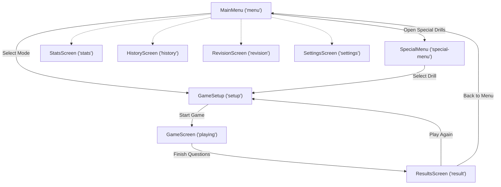

# ZenMath — Minimalist Mental Arithmetic Trainer

<p align="center">
  
  
  
  
  
  
  
  
</p>

---

## 📌 Overview

**ZenMath** is an offline-first, distraction-free progressive web app (PWA) crafted to train rapid mental calculation, numerical intuition, and mathematical fluency.

Featuring **14 targeted game modes**, real-time adaptive difficulty scaling, HD audio sprite speech synthesis across 5 speed tiers, and an integrated statistics engine with local IndexedDB persistence, ZenMath delivers an instant, zero-latency training environment on both desktop and mobile devices.

---

## ✨ Features

- 🎯 **14 Targeted Game Modes**: Comprehensive drills covering elementary arithmetic, mixed operations, fractions, percentages, square roots, ratio proportions, number series, and multi-step chain calculations.
- 📈 **Dynamic Adaptive Difficulty**: Automatically scales digit lengths, number ranges, and question complexity when user accuracy surpasses 85%.
- 🔊 **Dual Audio Feedback Engine**:
  - Pre-recorded HD audio sprites with smooth Web Audio API playback across 5 speed tiers (1.0x, 1.25x, 1.5x, 1.75x, 2.0x).
  - Web Speech API (TTS) voice announcements for seamless question narration.
- 💾 **100% Client-Side Data Privacy**:
  - Full IndexedDB storage (`zenmath-db`) logging every session and per-question timestamp, answer, and latency.
  - Daily progress, streak counts, and settings saved to `localStorage`.
- 📊 **Insightful Analytics & Revision**:
  - 7-day interactive performance charts and per-mode accuracy breakdowns.
  - Interactive revision tables for multiplication (1–20), squares (1–25), and fraction-to-decimal reference cards.
- 📱 **Progressive Web App (PWA)**:
  - Fully installable on iOS, Android, macOS, and Windows.
  - Complete offline functionality powered by Workbox runtime caching.
  - Custom touch-optimized numeric keypad with instant tactile response.
- 🌓 **Zen Minimalist Themes**: Seamless toggle between **Zen Obsidian** (pure dark mode `#000000`) and **Paper Zen** (clean light mode `#F4F4F5`).
- 🔔 **Daily Training Reminders**: Web Push notification integration with service worker dispatch and Vercel serverless push API.

---

## 🏗️ Architecture & Screen State Machine

ZenMath avoids heavy external routing libraries in favor of a centralized, high-performance state machine orchestrating screen transitions:



### Component Hierarchy

```
<ThemeProvider>                    # Dark / Light Theme Context
  <ToastProvider>                  # Transient toast alerts
    <ErrorBoundary>                # Fault-tolerant runtime wrapper
      <ZenLayout>                  # Unified shell with navbar and audio listeners
        ├── <MainMenu>             # Mode selection grid & quick actions
        ├── <GameSetup>            # Pre-session configuration
        ├── <GameScreen>           # Active game, timer & numeric keypad
        │     └── <Keypad>         # Custom touch keypad (integers, fractions, decimals)
        ├── <ResultsScreen>        # Accuracy breakdown & retry controls
        ├── <SpecialMenu>          # Specialized calculation categories
        ├── <SettingsScreen>       # Audio speeds, timers, and notifications
        ├── <StatsScreen>          # Visual performance metrics & charts
        ├── <HistoryScreen>        # Chronological session logs with filters
        └── <RevisionScreen>       # Quick reference multiplication & square charts
      <OfflineIndicator>           # Network connectivity banner
```

---

## 🎮 Game Modes

### 1. Basic Operations
| Mode | Description | Configurable Options |
|---|---|---|
| **Addition** | Addition of 1 to 4+ digit numbers | Digits, timeout, difficulty |
| **Subtraction** | Subtraction with positive or negative constraints | Allow negative results, digits |
| **Multiplication** | Multiplication drills | Multiplier/multiplicand ranges |
| **Division** | Division operations | Exact division or allow remainders |
| **Mixed Operations** | Dynamic mix of addition, subtraction, multiplication & division | Select active operators |

### 2. Specialized Drills
| Mode | Description | Configurable Options |
|---|---|---|
| **Multiplication Tables**| Focused single-table or range practice (1–10, 11–20, 1–20) | Custom table range |
| **Square Numbers** | Fast squares calculation ($x^2$) | Fixed (1–25) or custom bounds |
| **Fractions** | Fraction-to-decimal and decimal-to-fraction conversions | Numerator / denominator bounds |

### 3. Advanced Mental Math
| Mode | Description | Example Challenge |
|---|---|---|
| **Percentages** | Rapid percentage calculations | *"Find 15% of 240"* |
| **Square Roots** | Perfect square roots and root approximations | *$\sqrt{289} = 17$* |
| **Approximations** | Large number mental rounding & estimation | *$4,892 \times 31 \approx 150,000$* |
| **Number Series** | Finding missing sequence values (Arithmetic, Geometric, Fibonacci) | *$2, 6, 18, 54, \dots$* |
| **Ratios** | Solving proportion equations | *$3 : 7 = x : 35$* |
| **Chain Calculations** | Multi-step sequential mental arithmetic without paper | *$14 + 8 \times 3 - 5$* |

---

## 🗄️ Data Storage & Privacy

All user data is stored strictly on the user's local device:

| Data Type | Storage Layer | Identifier / Store Key | Purpose |
|---|---|---|---|
| **Sessions & Logs** | IndexedDB | `zenmath-db` (`sessions` store) | History of completed game rounds with scores and accuracy |
| **Per-Question Data** | IndexedDB | `zenmath-db` (`questions` store) | Detailed millisecond latency, user answers, and expected answers |
| **App Settings** | LocalStorage | `zenmath-settings` | Audio speed, question count, speech engine toggle |
| **Daily Streak** | LocalStorage | `zenmath-daily-progress` | Daily practice goal completion and active streaks |
| **Theme Selection** | LocalStorage | `zenmath-theme` | User theme preference (`dark` or `light`) |

---

## ⚡ Getting Started

### Prerequisites
- **Node.js**: v18+ (Node 20+ recommended)
- **npm** or **pnpm**

### Installation

1. **Clone the repository:**
   ```bash
   git clone https://github.com/ShihabulSakib/zenmath.git
   cd zenmath
   ```

2. **Install dependencies:**
   ```bash
   npm install
   ```

3. **Start local development server:**
   ```bash
   npm run dev
   ```
   Open `http://localhost:5173` in your browser.

4. **Production Build & Preview:**
   ```bash
   npm run build
   npm run preview
   ```

---

## 🔔 Web Push Notifications Setup

ZenMath supports daily study reminders using standard Web Push APIs:
- Client subscription is registered through `public/sw.js` via `src/services/notifications.ts`.
- Push dispatch endpoint is provided under `api/push.ts` for Vercel Serverless deployment using `web-push`.
- Configure `VAPID_PUBLIC_KEY`, `VAPID_PRIVATE_KEY`, and `VAPID_SUBJECT` in your hosting environment variables as outlined in [NOTIFICATION_SETUP.md](NOTIFICATION_SETUP.md).

---

## 🏛️ Algorithmic Foundation

The algorithmic core and timing models in ZenMath originate from the included C99 reference implementation ([`mental_arithmetic.c`](mental_arithmetic.c)), which implements deterministic pseudo-random problem generation, non-blocking POSIX input loops, and strict difficulty grading.

---

## 📄 License

This project is open-source software licensed under the [MIT License](LICENSE).
